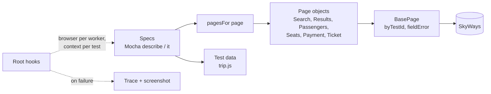

<div align="center">

# ✈️ Playwright + Mocha UI Framework

**UI tests for SkyWays flight booking with Playwright, Mocha and traces on every failure**

   

[](https://github.com/skamirullah/practiceqa-playwright-mocha-ui/actions/workflows/ci.yml)  

[What it tests](#-what-it-tests) · [Quick start](#-quick-start) · [How it is built](#-how-it-is-built) · [Structure](#-project-structure) · [Reports](#-reports-and-debugging)

</div>

---

## 👋 Overview

A UI automation framework that pairs Playwright's browser engine and web-first assertions with the Mocha test runner. It books flights end to end and covers search, filtering, seat selection, payment and validation.

|  |  |
|---|---|
| **App under test** | [SkyWays](https://www.practiceqaautomation.com/apps/flights), a flight booking app with search, fares, seat maps and tickets |
| **Kind of testing** | UI, end to end |
| **Tests** | 12 tests |
| **Runs in** | Chromium, Firefox or WebKit |

### Highlights

- **Web-first assertions.** `expect(locator)` retries until the page catches up, so there are no manual waits.
- **Trace on failure.** A failed test saves a Playwright trace and a full-page screenshot.
- **Fresh context per test.** One browser per worker, an isolated context for each test.
- **Parallel option.** `npm run test:parallel` runs spec files side by side.

## 🎯 What it tests

| Area | What is checked |
|---|---|
| Search | One-way search, every missing field listed, return date required for a round trip |
| Travellers | Summary updates when an adult is added |
| Results | Count matches the flights listed, non-stop filter, cheapest first |
| Booking | Two travellers with chosen seats, ticket with a PNR |
| Seats | Skipping seat selection assigns seats at check-in |
| Payment | Amount charged equals the amount quoted; a short card number is refused |
| Passenger validation | Name, email and phone errors on their own fields |

## 🚀 Quick start

**You need:** Node.js 20+.

```bash
git clone https://github.com/skamirullah/practiceqa-playwright-mocha-ui.git
cd practiceqa-playwright-mocha-ui
npm install
npx playwright install chromium
```

| Command | What it does |
|---|---|
| `npm test` | Run every spec headlessly in Chromium |
| `npm run test:smoke` | Run only tests tagged `@smoke` |
| `npm run test:headed` | Watch the browser |
| `npm run test:firefox` | Run in Firefox (`test:webkit` for WebKit) |
| `npm run test:parallel` | Run spec files in parallel |
| `npm run trace artifacts/<name>.zip` | Open the trace of a failed test |

## 🧱 How it is built



- **Mocha root hooks own the browser.** Tests receive `this.page`; they never launch or close anything.
- **Page objects return locators.** Assertions stay in the tests and use Playwright's auto-retrying `expect`.
- **One factory for pages.** `pagesFor(page)` builds every page object, so a test destructures what it needs.
- **Configuration from the environment.** Browser, headless mode and base URL come from environment variables with sensible defaults.
- **ES modules and ESLint** keep the code modern and consistent.

## 📁 Project structure

```text
src
├── config/env.js                   # base URL, browser, headless, timeouts
├── hooks/rootHooks.js              # browser, context, trace and screenshot
├── pages/                          # basePage, searchPage, resultsPage, passengersPage,
│                                   # seatsPage, paymentPage, ticketPage, index
└── data/trip.js                    # airports, travellers, cards
test
├── search.spec.js
├── results.spec.js
└── booking.spec.js
.mocharc.json                       # spec pattern, hooks, timeout, retries, reporter
```

## ⚙️ Configuration

Set these as environment variables, or copy `.env.example` and export it.

| Setting | Default | What it does |
|---|---|---|
| `BASE_URL` | the live site | Site to test. |
| `BROWSER` | `chromium` | `chromium`, `firefox` or `webkit`. |
| `HEADLESS` | `true` | Set to `false` to watch the browser. |
| `SLOW_MO` | `0` | Milliseconds to pause between actions. |

## 📊 Reports and debugging

- **Mochawesome**: `reports/ui-report.html`.
- **Traces**: a failed test writes `artifacts/<test>.zip`; open it with `npm run trace` to step through the run.
- **Screenshots**: a full-page screenshot is saved next to the trace.

## 🔁 Continuous integration

[GitHub Actions](.github/workflows/ci.yml) installs the browser, lints and runs the specs on every push and pull request, and uploads reports and traces.

## 🧪 About the app under test

SkyWays has airport autocomplete, date chips, a traveller picker, filters and sorting, two fare types, a seat map that moves from one traveller to the next, and a ticket with a booking reference.

[PracticeQAAutomation](https://www.practiceqaautomation.com) is a free practice site for QA engineers, with realistic apps to automate with Selenium, Playwright and Cypress. All data in these tests is fictional.

## 👤 Author

**Sk Amir Ullah** · Technical Lead, SDET and Test Automation

[Portfolio](https://skamirullah.com) · [LinkedIn](https://linkedin.com/in/skamirullah) · [GitHub](https://github.com/skamirullah) · [PracticeQAAutomation](https://www.practiceqaautomation.com)

## 📄 License

[MIT](LICENSE)
